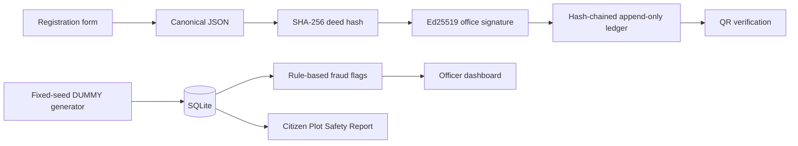

# Daffodil DeedGuard

**A DUMMY-only tamper-evident deed registry for the LandTech 2026 hackathon.**
It demonstrates a hash-chained append-only log, Ed25519 signatures, QR-ready
verification URLs, double-sale flags, and a citizen Plot Safety Report. It is
not a blockchain, legal advice, or a connection to any government system.

## Run the three-minute demo

```powershell
python -m venv .venv
.venv\Scripts\Activate.ps1
pip install -e ".[test]"
python scripts\seed_demo.py
uvicorn app.main:app --reload
```

Open `http://127.0.0.1:8000`. Every person, ID, address, plot, and deed is
generated by our fixed-seed script and marked **DUMMY**. No portal is queried.
Run tests with `pytest`. On Windows, `.\scripts\demo.ps1` resets the database
and starts the server. Docker users can run `docker build -t deedguard .` then
`docker run -p 8000:8000 deedguard`.

## Architecture



The flow is deliberately not called a blockchain: it is a local,
hash-chained append-only log. Registration creates a printable deed and QR
URL. Verification can be done by QR/deed ID or with the `POST /api/verify/{id}`
endpoint and a JSON copy of the deed fields. Results are exactly
`AUTHENTIC`, `ALTERED`, or `NOT FOUND`; altered responses list differing fields.

## Scope and safety

This is a hackathon prototype for P2 (digital deed verification), with P3
fraud flags and P5 safety reports. Mutation, pending-case, khas/acquisition,
and rapid-transfer behaviour are simulated rules, not statements of
Bangladeshi law or office procedure. There is no scraping, automated querying,
real government portal access, real identity data, or third-party record.
The private demo key is stored at `~/.daffodil-deedguard-demo.key`, outside the
repository. Production would use an HSM/KMS and controlled key rotation.

Libraries: FastAPI (MIT), Jinja2 (BSD-3-Clause), cryptography (Apache-2.0/BSD),
qrcode (BSD), pytest (MIT). AI assistance was used for scaffolding, code
generation, and test design. The demo key is generated at runtime; production
would use an HSM/KMS and a managed office key.

## Future: countrywide rollout

Pilot in one upazila with authorised stakeholders, then district, then national
integration with sub-registry and AC Land systems. Such integration requires
formal governance, security review, privacy controls, and legal approval.
